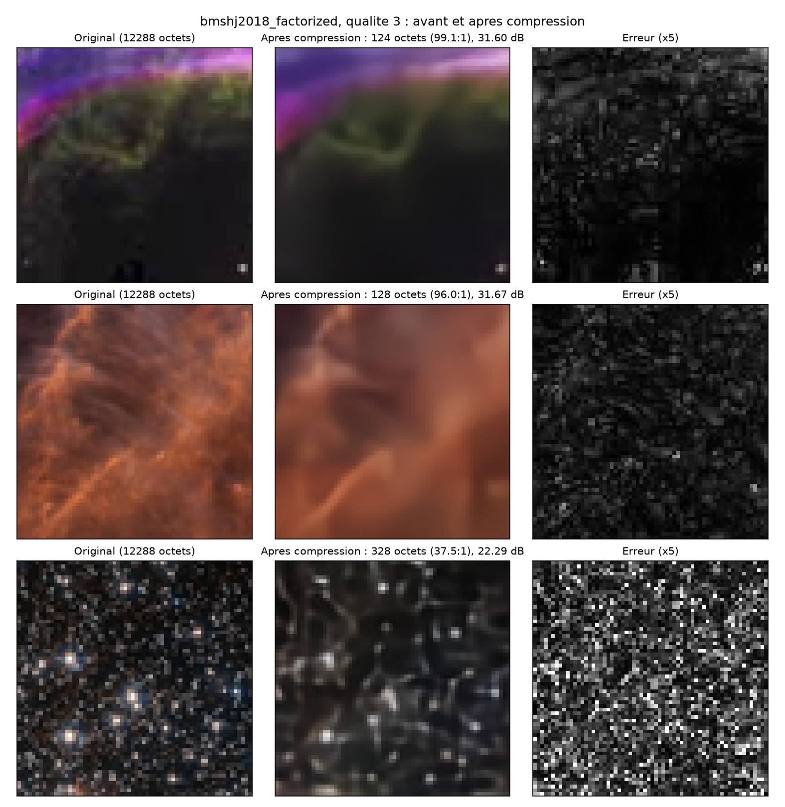

# Résultats mesurés

## Référence PC – bmshj2018_factorized (CompressAI), 200 images 64×64 du dossier `test`

| Qualité | bpp | Taux | PSNR moyen | Compression | Décompression |
|---|---|---|---|---|---|
| 1 | 0,138 | 174:1 | 25,4 dB* | 3,5 ms | 3,8 ms |
| 3 | 0,314 | 76:1 | 27,6 dB* | 3,3 ms | 3,6 ms |
| 5 | 0,699 | 34:1 | 30,4 dB* | 3,7 ms | 4,2 ms |
| 8 | 2,114 | 11,4:1 | 35,4 dB* | 9,5 ms | 10,5 ms |

\* PSNR calculé à partir de l'erreur moyenne sur les 200 images. En moyennant le PSNR image par image
(`bench_cai.py` actuel) on obtient 28,2 / 30,5 / 33,0 / 37,8 dB. L'écart entre la pire et la meilleure image
est d'environ 23 dB : le modèle ne règle pas son débit selon le contenu.

## Carte PYNQ-Z2 – les 4 convolutions de l'encodeur (150,7 M MAC, convolutions seules)

Conv 5×5, stride 2, float32 : 3→128 (64×64), 128→128 (32×32), 128→128 (16×16), 128→192 (8×8).
GDN, quantification et codage entropique non inclus.

| Version | Encodeur (ms) | M MAC/s |
|---|---|---|
| Naïf, `-O2` (réglage actuel de LoCoD) | 3199 | 47 |
| Naïf, `-O3 -ffast-math` (vectorisation auto) | 1219 | 124 |
| **NEON à la main v1, `-O2`** | **667 – 717** | **210 – 226** |
| NEON v1, `-O3 -ffast-math` | 1251 – 1280 | 118 – 120 |
| NEON v2 (poids pré-rangés, blocs de 16 canaux) | 909 – 968 | 156 – 166 |

Détail par couche (naïf `-O2` → NEON v1 `-O2`) : L1 185 → 30 ms, L2 2240 → 512 ms, L3 559 → 126 ms, L4 210 → 49 ms.

Conclusions :
- NEON v1 en `-O2` est 4,5 à 4,8× plus rapide que le code naïf, avec un résultat identique.
- L'hypothèse « les poids ne tiennent pas dans le cache » n'est pas confirmée : v2 est plus lente que v1.
- Plafond observé vers 220 M MAC/s en float : on arrête l'optimisation CPU en float ici.
- Estimation : l'encodeur seul demande ≈ 0,7 s par image 64×64 sur le CPU, soit environ 200× le temps du PC.

## Programme LoCoD CPU seul (`locod_conv_test`)

Couche 1 (3→128, 64×64) : 156,2 ms par appel sur la carte, checksum 1039,4556 (identique sur PC).

## Export ONNX

- Encodeur `ga.onnx` : image 1×3×64×64 → 1×192×4×4 ; opérateurs `Conv`, `Div`, `Mul`, `Sqrt` ; écart avec PyTorch ≈ 5e-6.
- Décodeur `gs.onnx` : opérateurs `Conv`, `ConvTranspose`, `Mul`, `Sqrt` ; écart ≈ 5e-7.
- Environ 6 Mo chacun (≈ 1,5 M de paramètres en float32).

## Benchmark complet sur la carte (200 images)

Modèle : bmshj2018_factorized, qualité 3. 200 images 64x64 RGB (24 bits/pixel brut), échantillon tiré avec seed 0.
Carte : implémentation C complète (`05_benchmark_carte/balle.c`), float32, NEON, `-O2`, un seul cœur.

| | PC (PyTorch) | Carte (C) |
|---|---|---|
| Octets moyens | 160.8 | 158.3 |
| PSNR moyen (dB) | 30.47 | 30.47 |
| Compression (ms/image) | 3.5 | 922.7 |
| Décompression (ms/image) | 3.7 | 861.8 |
| Bits par pixel | 0.314 | 0.309 |
| Taux de compression | 76.4:1 | 77.6:1 |

- Écart de taille par image : moyen 2.5 octets, max 4 (coder rANS maison vs celui de CompressAI).
- Écart de PSNR par image : moyen 0.000 dB, max 0.027 dB.
- Carte / PC : compression x260 plus lente, décompression x235 plus lente.

### Vérification de justesse
- Image 0 : 0 symbole différent sur 3072, écart max de l'image reconstruite 4.97e-07.
- 200 images : aller-retour de l'entropie OK.

### Répartition du temps (compression, ≈ 923 ms)
- Convolutions : ≈ 670 ms
- GDN + arrondi + rANS : ≈ 250 ms
- Décompression ≈ 862 ms. Total ≈ 1.8 s par image.

### Limites
- Coder rANS écrit à la main (probabilités 16 bits), pas celui de CompressAI.
- Dernière déconvolution complétée à 8 canaux (3 -> 8) pour le NEON.
- Float32, pas de quantification int8, `-O2`, CPU seul (pas de FPGA).
- Le PC mesuré est un CPU x86 avec PyTorch : l'écart de vitesse est un ordre de grandeur, pas une comparaison équitable.

### Pistes
Mesurer le temps par couche, simuler l'int8, choisir les fonctions candidates FPGA (convolutions ≈ 73 % du temps de compression).

## Cinq modèles CompressAI exportés en ONNX (qualité 3, image 64x64)

Détails et usage : `03_export_onnx/README.md`. Millions de multiplications des convolutions :

| Modèle | g_a (encodeur) | g_s (décodeur) | hyper et entropie |
|---|---|---|---|
| bmshj2018-factorized | 150,7 | 150,7 | aucun |
| bmshj2018-hyperprior | 150,7 | 150,7 | h_a 5,6 / h_s 5,6 |
| mbt2018-mean | 150,7 | 150,7 | h_a 5,6 / h_s 22,1 |
| mbt2018 | 324,4 | 324,4 | h_a 9,9 / h_s 22,4 / contexte 29,5 / entropie 16,3 |
| cheng2020-anchor | 653,3 | 1009,8 | h_a 6,0 / h_s 14,0 / contexte 13,1 / entropie 7,2 |

Estimation du temps de convolutions sur la carte (calcul : multiplications divisées par 220 millions par seconde, vitesse mesurée ; ce n'est pas une mesure) :
encodeur complet environ 0,7 s pour bmshj2018-factorized et hyperprior, 0,8 s pour mbt2018-mean, 1,8 s pour mbt2018, 3,2 s pour cheng2020-anchor (décodeur 4,7 s).

Écart ONNX / PyTorch : inférieur à 3e-5 pour tous les sous réseaux.

## Test du FPGA

Détails et procédure : `06_test_fpga/README.md`.

- `fpgautil -b fpga_swapped.bin` : chargé en 68 ms, état `operating`.
- Exemple LoCoD (matvec puis relu_quant) : matvec 217,2 µs, relu_quant 16,0 µs, total 233,2 µs.
- Vérification FPGA contre CPU : OK.
- Ce n'est pas notre modèle : c'est un exemple de test fourni par un camarade.

## Comparaison des 5 modèles à débit égal et à qualité égale

Script : `01_compressai/courbes_modeles.py` (mesures dans `01_compressai/courbes_modeles.csv`, graphique `01_compressai/courbes_modeles.png`).
100 images 64x64 du jeu de test, niveaux de qualité 1 à 8 (1 à 6 pour cheng2020_anchor). Débit réel après codage entropique, PSNR après décompression.

### Mesures (débit en bits par pixel, PSNR en dB)

| Qualité | factorized | hyperprior | mbt2018_mean | mbt2018 | cheng2020_anchor |
|---|---|---|---|---|---|
| 1 | 0,141 / 28,17 | 0,177 / 28,34 | 0,169 / 28,41 | 0,164 / 28,69 | 0,193 / 29,10 |
| 2 | 0,214 / 29,29 | 0,261 / 29,53 | 0,251 / 29,68 | 0,251 / 29,88 | 0,272 / 30,29 |
| 3 | 0,322 / 30,41 | 0,387 / 30,83 | 0,373 / 30,96 | 0,368 / 31,18 | 0,366 / 31,39 |
| 4 | 0,491 / 31,71 | 0,559 / 32,28 | 0,544 / 32,35 | 0,541 / 32,58 | 0,536 / 33,08 |
| 5 | 0,720 / 32,97 | 0,774 / 33,56 | 0,801 / 33,95 | 0,819 / 34,12 | 0,734 / 34,39 |
| 6 | 1,108 / 34,65 | 1,115 / 35,26 | 1,098 / 35,43 | 1,109 / 35,55 | 0,976 / 35,62 |
| 7 | 1,571 / 36,13 | 1,520 / 36,80 | 1,500 / 36,99 | 1,527 / 37,10 | |
| 8 | 2,163 / 37,85 | 2,011 / 38,49 | 1,955 / 38,48 | 1,976 / 38,47 | |

### Qualité (PSNR en dB) à débit égal

| Débit (bpp) | 0,20 | 0,30 | 0,40 | 0,50 | 0,70 | 1,00 |
|---|---|---|---|---|---|---|
| Taux de compression | 120:1 | 80:1 | 60:1 | 48:1 | 34:1 | 24:1 |
| bmshj2018_factorized | 29,07 | 30,18 | 31,01 | 31,76 | 32,86 | 34,18 |
| bmshj2018_hyperprior | 28,66 | 29,93 | 30,94 | 31,78 | 33,12 | 34,68 |
| mbt2018_mean | 28,89 | 30,20 | 31,18 | 31,99 | 33,32 | 34,94 |
| mbt2018 | 29,18 | 30,42 | 31,44 | 32,25 | 33,46 | 35,02 |
| cheng2020_anchor | 29,21 | 30,62 | 31,73 | 32,72 | 34,17 | |

### Débit (bpp) nécessaire à qualité égale, et économie par rapport à bmshj2018_factorized

| PSNR visé | 30 dB | 32 dB | 34 dB | 36 dB |
|---|---|---|---|---|
| bmshj2018_factorized | 0,283 | 0,544 | 0,958 | 1,531 |
| bmshj2018_hyperprior | 0,307 (−8 %) | 0,526 (3 %) | 0,862 (10 %) | 1,310 (14 %) |
| mbt2018_mean | 0,281 (1 %) | 0,502 (8 %) | 0,810 (15 %) | 1,245 (19 %) |
| mbt2018 | 0,262 (7 %) | 0,470 (14 %) | 0,797 (17 %) | 1,230 (20 %) |
| cheng2020_anchor | 0,253 (11 %) | 0,427 (21 %) | 0,675 (30 %) | |

### Lecture

- Autour de 30 dB et 0,3 bit par pixel (le niveau de qualité 3 du banc de test), `bmshj2018_factorized` est presque aussi bon que `bmshj2018_hyperprior` et `mbt2018_mean`
  (écart de moins de 0,3 dB ; le hyperprior est même moins bon à bas débit).
- Les modèles plus lourds gagnent surtout à plus haute qualité. À 30 dB : mbt2018 −7 % d'octets, cheng2020_anchor −11 %.
- Coût de calcul (voir plus haut) : mbt2018 ×2,4 et cheng2020_anchor ×5,7 par rapport à factorized. Sur la carte, ce n'est pas rentable à ce niveau de qualité.
- Choix retenu pour la suite : `bmshj2018_factorized`, le plus léger et le plus simple (pas d'hyper-réseau ni de contexte).

### Limites

- Images de 64x64 : les modèles ont été entraînés sur de grandes images, et les hyper-réseaux travaillent ici sur un hyper-latent de 1x1. Cela désavantage probablement les modèles à hyper-réseau.
- Le PSNR ne mesure pas tout (une métrique perceptive pourrait classer les modèles autrement).
- Interpolation linéaire entre peu de niveaux de qualité : les pourcentages sont approximatifs. 100 images seulement.

## Quantification entière (int8) du modèle bmshj2018_factorized, simulée sur PC

Question : si les convolutions de l'encodeur et du décodeur travaillent en entiers (comme sur le FPGA), combien de qualité et de débit perd-on ? Script : `01_compressai/quantif_int8.py`, résultats bruts dans `01_compressai/quantif_int8.csv`.

### Méthode

- Modèle `bmshj2018_factorized`, qualité 3, 100 images 64x64 : 20 pour calibrer les échelles, 80 pour mesurer (images différentes).
- Quantifiés : les poids et les entrées des 8 couches de convolution (`g_a` et `g_s`). Restent en flottant, comme sur la chaîne cible : les GDN / IGDN, les biais, le modèle d'entropie et le codage rANS.
- Quantification symétrique simulée (on arrondit sur la grille entière puis on revient en flottant : mêmes valeurs qu'un calcul entier suivi d'un rescale). Poids : une échelle par canal de sortie. Entrées : une échelle par couche, au percentile 99,99 % sur les images de calibration.
- Débit estimé par la somme des -log2 des vraisemblances, ce qui revient au débit du codeur rANS à quelques octets d'en-tête près.

### Résultats

| Variante | PSNR (dB) | Perte PSNR | Débit (bpp) | Variation débit | Symboles différents |
|---|---|---|---|---|---|
| float (référence) | 30,25 | +0,00 | 0,312 | +0,0 % | 0,00 % |
| poids 8 bits | 30,16 | -0,09 | 0,313 | +0,4 % | 0,46 % |
| poids 8 + entrées 8 (int8) | 28,85 | -1,40 | 0,312 | -0,1 % | 1,13 % |
| poids 6 + entrées 8 | 27,89 | -2,36 | 0,323 | +3,5 % | 2,35 % |
| poids 4 + entrées 8 | 17,51 | -12,74 | 0,457 | +46,5 % | 9,78 % |
| poids 8 + entrées 6 | 27,18 | -3,07 | 0,332 | +6,4 % | 3,20 % |
| poids 6 + entrées 6 | 26,52 | -3,74 | 0,349 | +11,8 % | 4,19 % |
| poids 4 + entrées 4 | 11,82 | -18,43 | 0,527 | +69,1 % | 14,09 % |

Poids des convolutions : 11,55 Mo en float32, 2,89 Mo en int8 (2 886 400 paramètres).

### Lecture

- Les poids en 8 bits seuls ne coûtent presque rien (-0,09 dB, débit +0,4 %) : le stockage des poids peut passer de 11,55 à 2,89 Mo sans perte visible.
- La perte de l'int8 complet (poids et entrées) est de 1,40 dB, soit 4,6 % du PSNR. Elle vient des entrées (activations) : poids 8 bits seuls, -0,09 dB ; en ajoutant les entrées 8 bits, -1,31 dB de plus. Le débit ne bouge pas (0,312 bpp), donc le coût est entièrement de la distorsion.
- 8 bits est un seuil net : à 6 bits la perte passe à 2,4 à 3,7 dB et le débit augmente, à 4 bits le modèle s'effondre (-12,7 à -18,4 dB). Il ne faut pas descendre sous 8 bits sans réentraîner le modèle.
- Pour le FPGA : un calcul int8 est viable (le modèle reste utilisable à 28,85 dB, pour un débit identique), au prix d'environ 1,4 dB par rapport au flottant.

### Limites

- Simulation sur PC : les valeurs sont celles d'un calcul entier, mais ni les largeurs d'accumulation (int32) ni les arrondis de rescale exacts du FPGA ne sont reproduits. L'écart avec le matériel est attendu faible, à confirmer par la mesure.
- Une seule qualité (3), un seul modèle, 80 images 64x64 pour la mesure.
- Les échelles des entrées sont par couche (une valeur par couche), une échelle par canal ou un autre percentile pourraient réduire la perte, non testé.
- Pas d'entraînement tenant compte de la quantification (QAT) : c'est la piste habituelle pour retrouver la perte, non testée.

### Pistes

- Repérer la ou les couches qui perdent le plus et les garder en 16 bits ou en flottant (les convolutions qui concentrent les 1,3 dB).
- Tester une échelle par canal pour les entrées, le percentile 99,9 % ou le maximum.
- Mesurer d'autres niveaux de qualité (1 à 8) et le modèle `bmshj2018_hyperprior`.

## Exemples visuels avant / après compression

Script : `01_compressai/visuel_images.py` (compression et décompression réelles avec codage rANS, `python visuel_images.py 3`). Modèle `bmshj2018_factorized`, qualité 3, 3 images 64x64 tirées au hasard dans le jeu de test.

| Image | Octets | Taux de compression | PSNR |
|---|---|---|---|
| GSFC_20171208_Archive_e000607_011 | 124 | 99,1:1 | 31,60 dB |
| PIA21073_013 | 128 | 96,0:1 | 31,67 dB |
| GSFC_20171208_Archive_e000256_009 | 328 | 37,5:1 | 22,29 dB |

### Lecture

- Les deux premières images sont douces (dégradés, grandes zones peu texturées) : elles se compressent à environ 100:1 et gardent leur forme générale. Ce qui disparaît est la texture fine, d'où l'aspect lissé visible dans la colonne du milieu et les erreurs diffuses dans la carte des erreurs.
- La troisième est un champ d'étoiles, plein de petits détails isolés : elle coûte plus de 2,5 fois plus d'octets et la qualité chute à 22,3 dB. Les étoiles les plus brillantes sont reconnaissables, beaucoup de points faibles sont fondus ou déplacés, et l'erreur est répartie sur toute l'image.
- La qualité dépend donc fortement du contenu de l'image : la moyenne de 30,47 dB (200 images) cache des images à 22 dB et d'autres à plus de 31 dB.

### Limites

Trois images seulement, tirées au hasard (graine fixe) : c'est une illustration, pas une mesure statistique. Les statistiques sont dans le tableau des 200 images plus haut.

